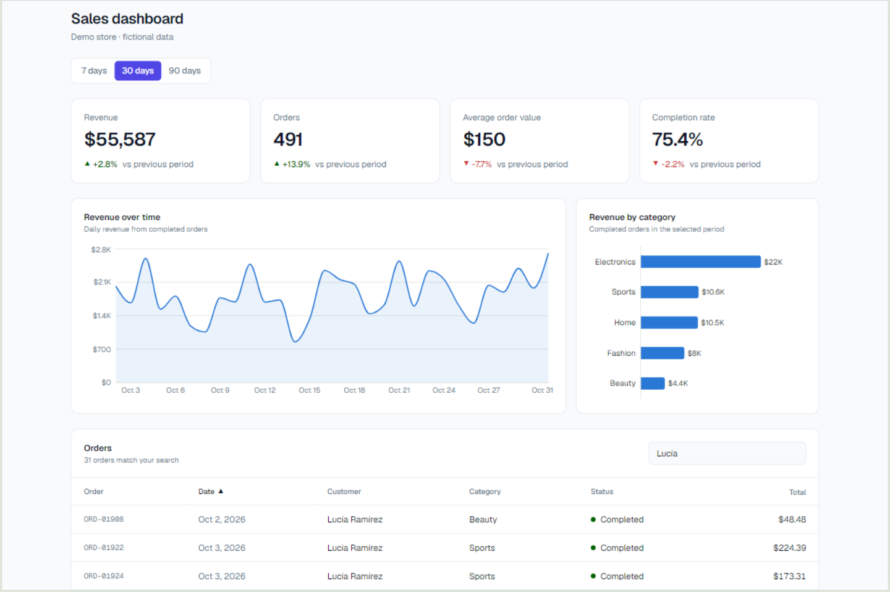
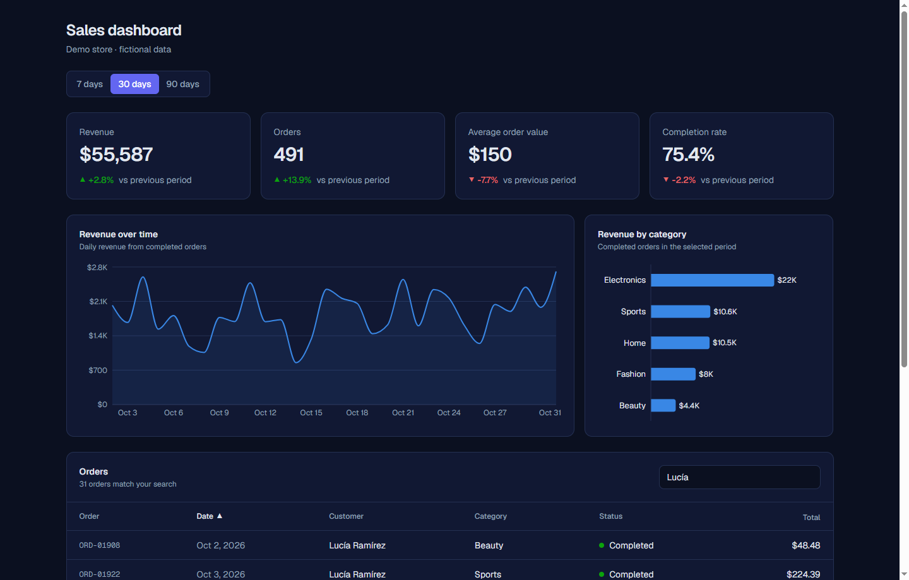
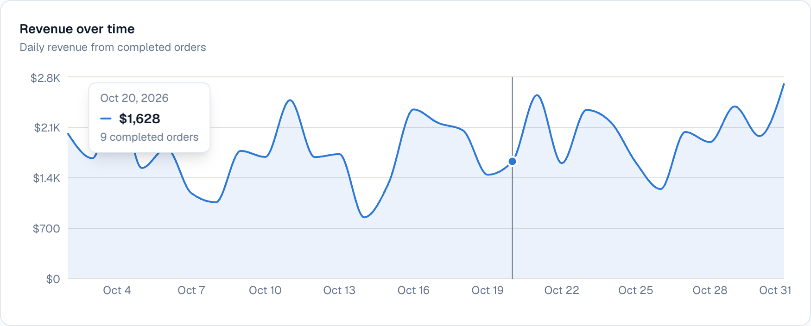
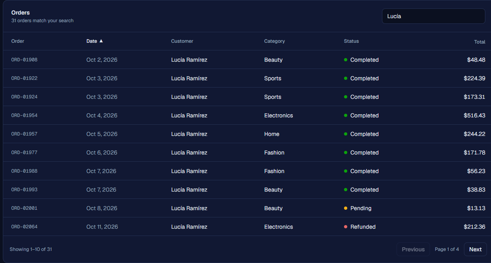
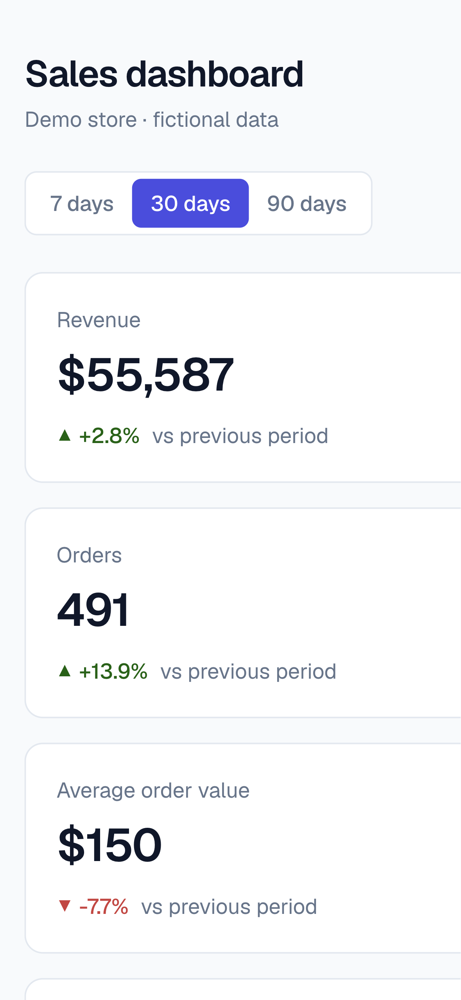

# Sales Dashboard

Dashboard de ventas para una tienda online ficticia, construido con **Next.js (App Router)**, **TypeScript** y **Tailwind CSS**. Muestra indicadores clave, gráficos de ingresos y una tabla de órdenes con búsqueda, orden y paginación.

**[Ver demo en vivo](https://next-sales-dashboard-vmirella.vercel.app/)** · [Código fuente](https://github.com/vmirella/sales-dashboard)



> Proyecto hecho para practicar el stack de React moderno (Next.js, TypeScript y Tailwind CSS). Vengo de varios años trabajando con Vue, así que aquí documento las decisiones que tomé al llevar esos conceptos a React.

## Funcionalidades

- **Indicadores clave (KPIs):** ingresos, órdenes, ticket promedio y tasa de completado, cada uno comparado con el periodo anterior.
- **Gráfico de ingresos en el tiempo** (área) y **gráfico de ingresos por categoría** (barras), con tooltips al pasar el cursor.
- **Tabla de órdenes** con búsqueda por cliente o id, orden por columna y paginación.
- **Filtro de rango de fechas** (7, 30 o 90 días) guardado en la URL: `/?range=30d`. Se puede compartir o guardar como favorito.
- **Modo oscuro** automático según la preferencia del sistema.
- **Diseño responsive**, con estado de carga (skeleton) y estados vacíos.
- **API de lectura:** `GET /api/orders?range=7d|30d|90d`.

## Capturas

<p align="center">
  
  
</p>
<p align="center">
  
  
</p>

## Stack

| Área              | Tecnología                                  |
| ----------------- | ------------------------------------------- |
| Framework         | Next.js 16 (App Router) y React 19          |
| Lenguaje          | TypeScript                                  |
| Estilos           | Tailwind CSS 4                              |
| Gráficos          | Recharts                                    |
| Calidad de código | ESLint y Prettier                           |
| Flujo de commits  | Husky, lint-staged, Commitlint y Commitizen |
| Despliegue        | Vercel                                      |

## Decisiones técnicas

- **Componentes de servidor por defecto.** Solo son componentes de cliente los que necesitan el navegador o estado: los dos gráficos (Recharts mide el DOM) y la tabla (búsqueda, orden y página).
- **El filtro de rango vive en la URL, no en estado.** Cada opción es un enlace a `/?range=…`. No hace falta estado en el cliente, la vista es compartible y el valor se valida en el servidor (`parseRange`): cualquier valor inválido vuelve a 30 días.
- **`searchParams` dentro de `<Suspense>` con Cache Components.** La estructura de la página se prerenderiza y el contenido que depende de la URL llega por streaming, con un skeleton mientras tanto.
- **Datos deterministas.** Con Cache Components, `Math.random()` y `Date.now()` rompen el build durante el prerender. Por eso el dataset se genera con un generador pseudoaleatorio con semilla y una fecha de referencia fija. Como ventaja, la demo es estable entre despliegues.
- **Lógica de negocio en funciones puras** (`src/lib/metrics.ts`): reciben arreglos y devuelven arreglos, sin React. Regla: solo las órdenes completadas cuentan como ingreso. Los casos sin datos devuelven `0` o `null`, nunca `NaN`.
- **Tabla con estado mínimo y datos derivados.** Solo se guardan la búsqueda, la columna de orden y la página. Las filas visibles se calculan en cada render (con `useMemo` para el filtrado y el orden). Si el rango cambia mientras estás en una página que ya no existe, la página se acota en lugar de sincronizarla con un `useEffect`.
- **Visualización de datos.** Cada gráfico tiene una sola serie, por lo que usa un único color y no lleva leyenda. Las etiquetas usan los colores de texto, no el de la serie, y los tooltips muestran el valor primero.
- **Accesibilidad.** La dirección del cambio en los KPIs y el estado de cada orden nunca dependen solo del color: llevan icono, signo o texto. Las columnas ordenables usan `aria-sort`, el buscador tiene etiqueta, hay foco visible en teclado y los gráficos incluyen una tabla oculta para lectores de pantalla.

## Cómo ejecutarlo localmente

Requiere Node.js 20.9 o superior.

```bash
git clone https://github.com/vmirella/sales-dashboard.git
cd sales-dashboard
npm install
npm run dev
```

Abre [http://localhost:3000](http://localhost:3000).

## Scripts

| Script              | Descripción                                          |
| ------------------- | ---------------------------------------------------- |
| `npm run dev`       | Servidor de desarrollo                               |
| `npm run build`     | Build de producción                                  |
| `npm run lint`      | Ejecuta ESLint                                       |
| `npm run typecheck` | Genera los tipos de rutas y ejecuta el compilador TS |
| `npm run format`    | Formatea el código con Prettier                      |
| `npm run commit`    | Asistente interactivo para escribir el commit        |

## Estructura del proyecto

```
src/
  app/              Rutas, layout y la ruta de API (/api/orders)
  components/       Componentes de interfaz (dashboard/, ui/)
  data/             Dataset ficticio y determinista
  lib/              Funciones puras: métricas, formato y rangos de fechas
  types/            Tipos compartidos de TypeScript
```

## Convención de commits

Los commits siguen [Conventional Commits](https://www.conventionalcommits.org/) y se validan automáticamente con Husky y Commitlint:

```
tipo(ámbito): descripción corta en imperativo
```

Tipos habituales: `feat`, `fix`, `docs`, `style`, `refactor`, `test`, `chore`, `build` y `ci`. El título admite un máximo de 72 caracteres. Con `npm run commit` puedes armar el mensaje paso a paso.

Hooks de Git:

- `pre-commit`: ejecuta lint-staged (ESLint y Prettier sobre los archivos en staging).
- `commit-msg`: valida el mensaje con Commitlint.

## Datos

Todos los datos son ficticios. Se generan con una semilla fija, por lo que son siempre los mismos, y no incluyen información real de clientes. La fecha de "hoy" de la demo es fija (31 de octubre de 2026).

## Posibles mejoras

- Pruebas automáticas para las funciones de `src/lib/metrics.ts`.
- Textos de la interfaz en español y moneda local mediante internacionalización.
- Datos reales desde una base de datos o una API externa, usando `"use cache"` para controlar la frescura.
- Filtros adicionales (categoría y estado) y rango de fechas personalizado.

## Autor

**<Virginia Contreras Villafuerte>** · [LinkedIn](https://linkedin.com/in/virginia-contreras) · [Portafolio](https://virginiacontreras.vercel.app/)
